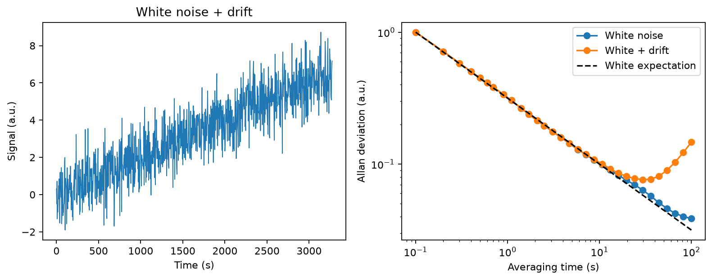

# Allan noise analysis — OptiIA Consulting

Analyze measurement stability versus averaging time with overlapping Allan deviation.

An executable project example using generated data. Images and graphs below are generated by the included code.



## Run

Python 3.12 recommended:
```bash
python -m pip install -r requirements.txt
python -m unittest -v test_analysis
python analysis.py --seed 42 --out results
```

The script writes plots, a data export and JSON metrics to `results/`. The committed `metrics.json` and `preview.png` correspond to seed 42. Import the functions in `analysis.py` to process your own compatible arrays.

## Method

For a uniformly sampled scalar series, compute all length-m moving averages from cumulative sums, then the mean squared difference between averages separated by m samples. Allan deviation is sqrt(0.5 mean(diff²)). Compare generated white noise with white noise plus slow linear drift over logarithmically spaced averaging factors.

## Assumptions and limitations

This uses direct scalar/frequency samples, not phase samples. Uniform sampling and no gaps are assumed. Long averaging times have few effectively independent samples; no confidence intervals or certified noise-type classification are supplied. Units remain those of the measured signal.

Synthetic results establish reproducibility of this example, not performance on real instruments. No proprietary source code, data or photographs are included.

## Validation

Four tests exercise exact reference cases, independent data or noise realizations, and input validation. See `test_analysis.py` for thresholds and checks.

## Related activities

Scientific computing, instrumentation data analysis, image processing and Python automation.

[More project examples](https://github.com/yaghi-ali) · [OptiIA Consulting](https://www.optiia-consulting.fr) · contact@optiia-consulting.fr
